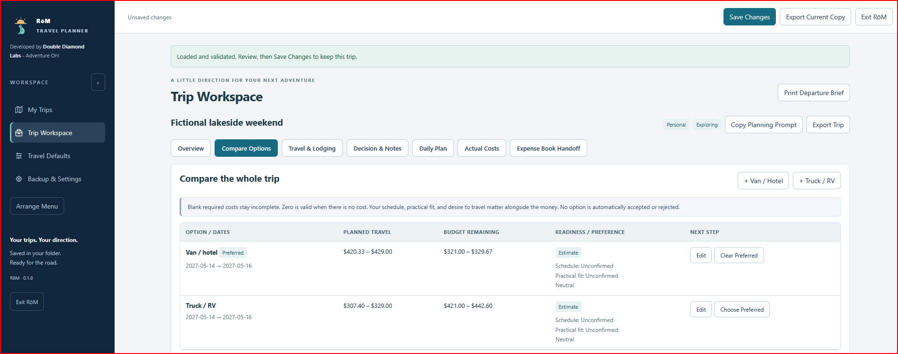
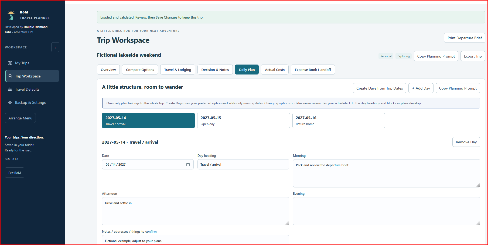

# RōM — offline trip planning

**Plan the trip. Compare the options. Adventure on.**

RōM (pronounced “roam”) is a small, local trip planner for personal getaways and
inspection-related business travel. Compare van/hotel and truck/RV options,
organize the days, and keep the details together without an online account.

Developed by **Double Diamond Labs — Adventure On!**

Built through an iterative, AI-assisted development process and tested in our daily workflow.
Automated checks support development; they are not a guarantee that every environment or scenario is covered.

> Public-release candidate v0.1.8. Not yet approved for public distribution.
> MIT license approved. The owner confirms the destination repository is new and empty.
> Demo screenshots are included. Remaining Windows checks and clean developer installation are pending.

## What it does

- Compares mileage, MPG ranges, fuel prices and high/low fuel allowances.
- Keeps travel, lodging, pet preferences, booking notes and estimated costs together.
- Provides a Daily Plan, printable departure brief, and optional checklist.
- Creates an editable planning prompt to copy into an AI chat of your choice.
- Records actual travel costs and exports local JSON backups.
- Offers optional file exchange with a compatible Expense Book installation.
  Expense Book and an AI subscription are not required for standalone trip planning.

## A look inside

Compare van/hotel and truck/RV estimates for the same fictional trip:

Organize the days without filling every hour:

These screenshots use the included fictional example, immediately after import.
The unsaved status is expected until **Save Changes** is selected.

## Download and start

When this candidate is approved, open this repository's **Releases** section and
choose `RoM-v0.1.8.zip`. GitHub's automatically generated “Source code” download is
intended for development. Existing users should use `RoM-Update-v0.1.8.zip`.

1. Install Python 3.10 or newer on each Windows computer that will run RōM.
2. Extract the complete application ZIP into a permanent folder.
3. Run `Install-Desktop-Shortcut.bat`, then open the new shortcut. Or run `Start-App.bat`.
4. Review Travel Defaults, create a personal or inspection trip, and click **Save Changes**.

No Python package installation is needed. Node/npm are for developer tests only.
Windows launchers are provided. Other operating systems have not received a native pilot.
Read [START-HERE.txt](START-HERE.txt) for updates, sharing, backup and recovery.

## Try a fictional trip

Use **Backup & Settings → Import Trip** with
[examples/weekend-demo.json](examples/weekend-demo.json). It adds a fictional trip;
it does not restore or replace your workspace. Review it, then Save Changes if you
want to keep it. Its prices, mileage and locations are illustrative, not recommendations.

## Privacy and limits

Trips are stored in `Data/trips.json` beside the application. Previous-save copies
are kept in `Data/Backups`. Keep separate exported backups too. Data is not encrypted
by RōM; protect the computer/share and any exported files.

The app has no built-in AI service, account, telemetry or online map/fuel lookup.
Copying a planning prompt into another service is your choice; review its contents first.
Costs are estimates. Check routes, reservations, accessibility, pet rules and prices yourself.
Inspection revenue remaining after travel costs is not a profit or tax calculation.

Use one editing session at a time on a shared folder. Revision checks help detect
conflicts; this is not a real-time collaboration service. Save explicitly before closing.
RōM runs on loopback; do not expose its server to the internet.

## Support and contributing

This is a personal project, maintained as time permits. There is no guaranteed
response time, release schedule, or commitment to implement requests.
See [SUPPORT.md](SUPPORT.md) and [CONTRIBUTING.md](CONTRIBUTING.md).
Please use fictional examples in issues; never attach actual customer or financial data.

## Development

Use a separate development folder and a compatible Node release (see package.json).
Run `npm ci`, then `python build_release.py`. The build runs Python and JavaScript
checks and creates application, updater and repository ZIPs from explicit allowlists.
End users do not need Node. See [docs/MAINTENANCE.md](docs/MAINTENANCE.md).

## License and review status

Licensed under the [MIT License](LICENSE). Copyright (c) 2026 Double Diamond Labs.
You may use, modify and redistribute this software, including commercially, subject
to the license terms. Third-party test dependencies retain their own licenses; see
[THIRD-PARTY-NOTICES.md](THIRD-PARTY-NOTICES.md).

The public-release preparation record is [docs/PUBLIC-RELEASE-REVIEW.md](docs/PUBLIC-RELEASE-REVIEW.md).
